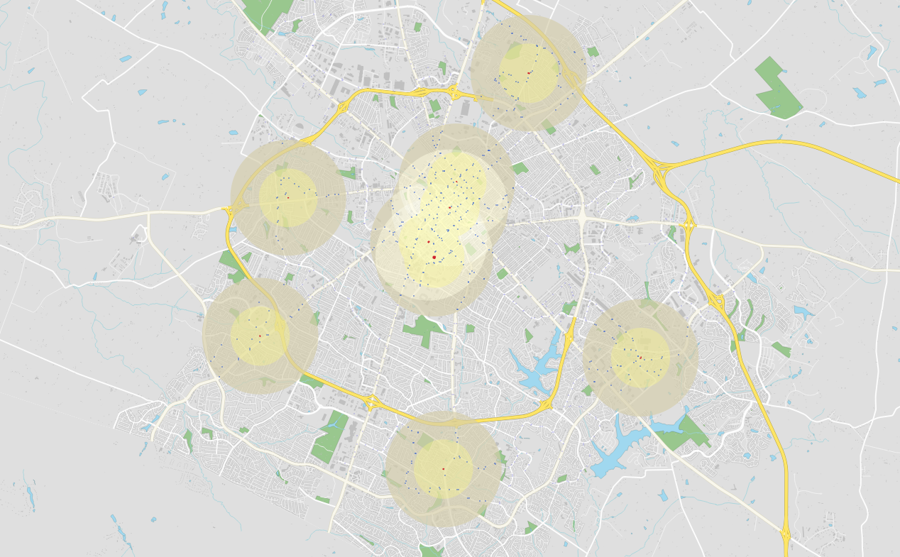

# 2.5 Independent Geoprocessing Analysis

How can I find all of the bus stops within a half mile and one mile radius of a library?

To answer this question, I used the OSM quick query to obtain bus stop points and library polygons. I used the buffer geoprocessing tool to create a half mile and one mile buffer around each library. I used the clip geoprocessing tool to extract just the bus stops that were inside the two buffers. I was pleasently surprised to see how many bus stops there were around each library, with most of them having a bus stop on the same street. The goal of this map was to see how accessible public libraries are from the bus, and this map definitely shows it is very easy to get to a library via bus.

